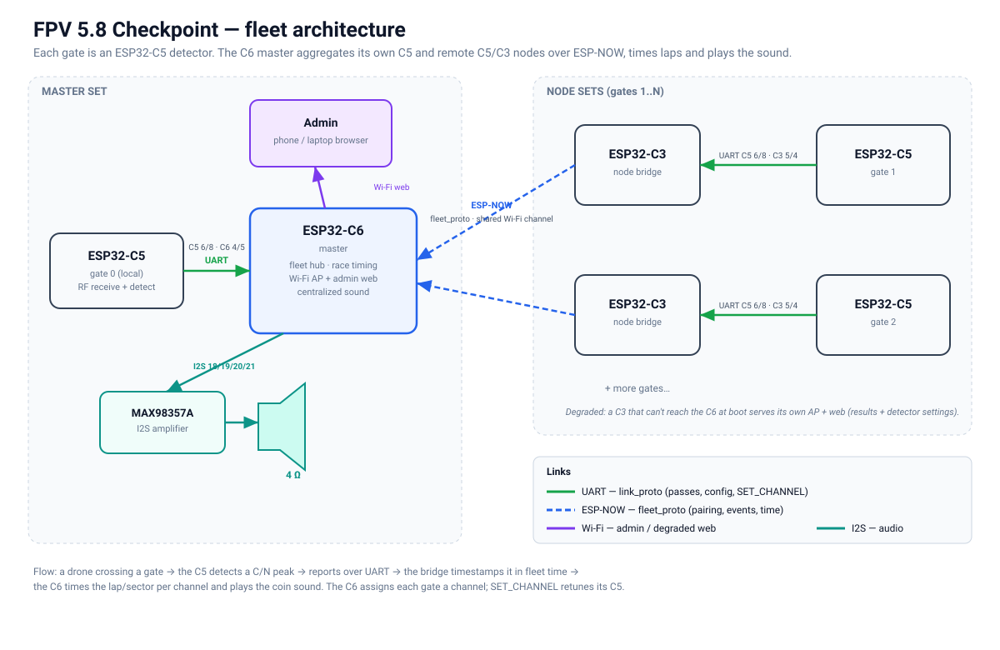

# FPV 5.8 Checkpoint

A **"a drone just passed"** platform: a C5 sweeps the 8 Raceband channels and
detects a drone pass on any of them, and a C6 master times it and plays a coin sound, with a
phone-friendly web UI to tune it and watch events. Each gate is a C5 wired to a
C3 (or to the C6); a C3 with no master in reach serves its own web page with the
passes. It scales to a multi-gate race-timing fleet.

> **Derivative.** This project adapts the receive engine of
> [C5VRX](https://github.com/Twotoz/C5VRX) — **C5VRX-5, by Twotoz and the C5VRX
> contributors** (forked at upstream commit `6bc9e4b`, modified since
> 2026-10-29). The upstream RF chain
> (MODEM_DIAG → BitScrambler → PARLIO → AGC and its control/calibration) is
> reused in the `components/c5vrx_rx` component, unchanged except for a 7-line
> `CONFIG_C5VRX_VIDEO_OUTPUT=n` pin routing in `transport.c`. **Modified for this
> video-off detector:** the component drops the upstream video menu/OSD/splash
> (`menu.c`, `menu_ui.c`, `menu_raster.c` and their font, logo and DAC-test
> headers), the field experiments (`experimental.c`, `experimental_phy.c`), the
> flight log (`flightlog.c`) and the bench labs (`sense_lab.c`,
> `calibration_bench.c`); `menu_stub.c` and `pruned_stubs.c` stand in for them
> with the video-off behaviour, and `console.c` has the checkpoint hooks and a
> reduced key table (`AGENTS.md` "Repository sources" lists every change). This
> repository adds the pass detector, the coin sound (on the C6 master), and the
> C5↔C3/C6 platform around it.
> Visit the [official C5VRX website](https://twotoz.github.io/C5VRX/) for the
> original project; its Discord invite is available there. Licensed
> **GPL-3.0-only** (see `LICENSE`), without any warranty (sections 15–17), like
> C5VRX; the C3 and C6 web pages show this notice in their footer. This is
> **not** an official C5VRX release and is not endorsed by its authors.

## What it is

- **ESP32-C5** (`firmware/detector`, Waveshare ESP32-C5-Zero) — runs the full C5VRX
  receive chain, sweeps R1 to R8 and detects a pass on any of them, reported over a
  UART link to its bridge. It has no local output: no picture
  (`CONFIG_C5VRX_VIDEO_OUTPUT=n`), no amplifier and no status LED.
- **ESP32-C3** (`firmware/node`) — a node bridge: UART to the C5, ESP-NOW uplink to
  the C6 master; if no master is reachable at boot it falls back to a local
  Wi-Fi SoftAP + web (results, the C5's health and its
  calibrate/reboot commands).
- **ESP32-C6** (`firmware/master`) — the optional **race-timing master**: UART to its
  own C5, the centralized speaker, a Wi-Fi AP web, and an ESP-NOW hub that
  aggregates the C3 nodes. Each gate is a C5; the C6 times laps per channel,
  shows every gate's health and runs its calibrations and reboots (production
  has no USB console: [docs/fleet.md](docs/fleet.md#gate-health-and-remote-commands-no-console-in-production)).

The web has **two roles**: **spectators** watch the live standings and status
read-only (no login), while **admin** actions — pairing, gate order, reset,
volume, a gate's calibration or reboot, and (on a degraded C3) detector tuning
— require the admin password
(`CONFIG_*_ADMIN_PASSWORD`, no username): the admin toggle in the
header opens a password dialog. The password never crosses the Wi-Fi: the page
signs each admin request (HMAC-SHA256, per-session counter against replays)
with a key derived from it (PBKDF2), the only form the firmware holds. A sniffed
request still allows offline guessing, so choose a long random password
([docs/fleet.md](docs/fleet.md), `components/web_auth`).

## Layout

```
components/
  c5vrx_rx/      upstream C5VRX receive engine, pruned for a video-off detector (RF chain unchanged)
  checkpoint/    pass detection + the C5<->bridge UART link
  pass_detector/ pure-C pass detector (host-tested)
  audio_player/  I2S coin-sound player (the C6 speaker in a fleet)
  link_proto/    pure-C C5<->bridge UART protocol (host-tested)
  fleet_proto/   pure-C C6<->C3 ESP-NOW protocol (host-tested)
  race_timing/   pure-C lap/sector timing engine (host-tested)
  espnow_link/   ESP-NOW transport carrying fleet_proto (C6 + C3)
  status_led/    single-WS2812 status indicator (pure-C core host-tested)
  web_auth/      signed admin requests for the C3/C6 web (pure-C core + auth.js host-tested)
firmware/detector/  ESP32-C5 application (RF + detection, report-only)
firmware/node/      ESP32-C3 node bridge (UART + ESP-NOW relay, degraded Wi-Fi web)
firmware/master/    ESP32-C6 master (UART + ESP-NOW hub + speaker + admin web + timing)
docs/            CHECKPOINT.md (index) + detector/no-video-audio/fleet/status-led/bench, wiring-*.svg
```

See **[docs/CHECKPOINT.md](docs/CHECKPOINT.md)** for the feature notes, the fleet
and the bench procedure, and **[docs/wiring-node.svg](docs/wiring-node.svg)** for
a gate's wiring (C3 + C5).

## Build

The root `Makefile` is the quick path: `make firmware` builds every variant,
`make flash [FW=<name>] [PORT=<port>]` flashes one (interactive firmware/port
menu if an arg is omitted), `make monitor`, `make variants` (list the `FW=`
names: `detector`/`node`/`master` defaults plus variants like
`detector-xiao-c5`, `detector-wave-c5-lcd`, `master-wave-c5`), `make clean`. flash/monitor fall
back to esptool / a serial terminal on the already-built image when ESP-IDF is
not installed, so you can build in one place and flash in another.

For local, uncommitted settings — the Wi-Fi AP and admin-web passwords, or
enabling audio — put them in `firmware/<role>/sdkconfig.local.defaults` (one
`CONFIG_...=...` per line). It is gitignored, and `make`/`tools/fw.sh` append it
last so it overrides the committed defaults.

To work on the web pages without a board, `make web-master` (<http://127.0.0.1:8080/>)
or `make web-node` (port 8081) runs `tools/web_mock.py`: it serves the real pages from
disk, so a browser reload shows an edit, no build and no flash. `/api/*` answers like
the firmware on a simulated race, admin actions take effect (password `checkpoint`) and
signed requests are checked as on the ESP. `WEB_ARGS` passes its options: `--vtx` (a
strong carrier on every gate, for the calibration guard), `--latency 300`, `--host
0.0.0.0` (to open it from a phone), `--password ""`. Stopping and restarting it is an
ESP reboot.

The raw commands:

```sh
. ~/esp/esp-idf-v6.0.2/export.sh
( cd firmware/detector && idf.py build )  # esp32c5 → build/detector-c5.bin (0 warnings)
( cd firmware/node && idf.py build )      # esp32c3 → build/node-c3.bin
( cd firmware/master && idf.py build )    # esp32c6 → build/master-c6.bin
# temporary "C5 as master" (run the master firmware on a spare C5 until the C6 arrives) → build-c5/master-c5.bin:
( cd firmware/master && idf.py -DIDF_TARGET=esp32c5 -DSDKCONFIG=sdkconfig.c5 \
    -DSDKCONFIG_DEFAULTS=sdkconfig.c5.defaults -B build-c5 build )

# Host tests
cd test
cc -O2 -std=c11 -Wall -Wextra -Werror -I../components/pass_detector/include \
   test_pass_detector.c ../components/pass_detector/pass_detector.c -lm -o /tmp/t && /tmp/t
cc -O2 -std=c11 -Wall -Wextra -Werror -I../components/audio_player/include \
   test_audio_resample.c -lm -o /tmp/t && /tmp/t
cc -O2 -std=c11 -Wall -Wextra -Werror -I../components/link_proto/include \
   test_link_proto.c ../components/link_proto/link_proto.c -o /tmp/t && /tmp/t
cc -O2 -std=c11 -Wall -Wextra -Werror -I../components/fleet_proto/include -I../components/link_proto/include \
   test_fleet_proto.c ../components/fleet_proto/fleet_proto.c ../components/link_proto/link_proto.c -o /tmp/t && /tmp/t
cc -O2 -std=c11 -Wall -Wextra -Werror -I../components/race_timing/include \
   test_race_timing.c ../components/race_timing/race_timing.c -o /tmp/t && /tmp/t
cc -O2 -std=c11 -Wall -Wextra -Werror -I../components/status_led/include \
   test_status_led.c ../components/status_led/status_led.c -o /tmp/t && /tmp/t
cc -O2 -std=c11 -Wall -Wextra -Werror -I../components/web_auth/include \
   test_web_auth.c ../components/web_auth/web_auth.c -o /tmp/t && /tmp/t
cc -O2 -std=c11 -Wall -Wextra -Werror -I../components/checkpoint \
   test_hop_stats.c -o /tmp/t && /tmp/t
node test_web_auth.mjs   # the page side (auth.js), Node 18+
python3 test_web_mock.py # tools/web_mock.py against the firmware's /api/state and buffers
python3 test_scan_analyze.py   # tools/scan_analyze.py on synthetic recordings
```

## Architecture



- **Pin-level wiring, per set type:**
  - master **C6 + C5**: [docs/wiring-master.svg](docs/wiring-master.svg)
  - node **C3 + C5** (also a gate with no master: the C3 then serves the web): [docs/wiring-node.svg](docs/wiring-node.svg)
  - temporary **C5 + C5** (a spare C5 runs the master firmware until the C6 arrives): [docs/wiring-c5c5.svg](docs/wiring-c5c5.svg)

## Pinout

Each UART link is crossed (one side's TX to the other's RX) with a common
ground. Pins are Kconfig defaults (`menuconfig`). USB-Serial-JTAG (flashing/console)
is reserved on every board. [`hardware/`](hardware/README.md) has carrier PCBs for
both sets, with Gerbers ready to order.

**ESP32-C5** (`firmware/detector`, detector — one per gate)

| Function | GPIO | Notes |
| --- | --- | --- |
| Link UART TX → bridge RX | 6 | to a C3 (node) or the C6 (master) |
| Link UART RX ← bridge TX | 8 | C5-Zero header pin (GPIO 15 is not broken out) |
| Amplifier / status LED | — | none on a detector: the C6 master plays the sound |
| forbidden | 0-5, 25, 27 (IQ) · 13,14 (USB) · 16-22 (flash) · 26 (antenna) | receiver-owned |

**ESP32-C3** (`firmware/node`, node bridge)

| Function | GPIO | Notes |
| --- | --- | --- |
| UART TX → C5 RX (8) | 5 | |
| UART RX ← C5 TX (6) | 4 | |
| Wi-Fi / ESP-NOW | — | no GPIO; ESP-NOW to the C6 on the shared AP channel |

**ESP32-C6** (`firmware/master`, master)

| Function | GPIO | Notes |
| --- | --- | --- |
| UART TX → local C5 RX (8) | 4 | |
| UART RX ← local C5 TX (6) | 5 | |
| Amplifier BCLK / LRC / DIN / SD | 18 / 19 / 20 / 21 | the centralized speaker; `VIN` 5 V, `OUT±` to a 4 Ω speaker |
| Wi-Fi AP + ESP-NOW | — | admin web + fleet hub; same channel as the nodes |

The C6 AP, the C3 APs and ESP-NOW must share the **same Wi-Fi channel**
(`CONFIG_C6_AP_CHANNEL` / `CONFIG_C3_AP_CHANNEL`).

## Safety

> [!WARNING]
> This is experimental and built on an experimental FPV receiver. Bugs, signal
> loss or automatic receive-chain changes can cause sudden loss of video or
> sync even after an apparently successful test. Do not rely on it as your only
> means of maintaining safe control of an aircraft.

## Attribution

Receive engine: **C5VRX** by Twotoz and the C5VRX contributors —
<https://github.com/Twotoz/C5VRX> · <https://twotoz.github.io/C5VRX/> (Discord
invite on the website). Reused material keeps its original copyright, license
and credits; see `AGENTS.md` for the reuse policy and `assets/BRANDING.md` for
branding terms.

C5VRX-5 builds on C5VRX-2..4 (the continuous MODEM_DIAG to BitScrambler video path,
Direct Gain V3-V5, the PAIR schedule and the U85Q study of PR #190), on zerowidth/C5VRX
PR #3 (interference-burst gate, sampling-phase probe, off-grid channel tuning), on Louis
Hitchcock's staged overload recovery (C5VRX #182/#184), and on ESPARGOS esp-sdr
(GPL-3.0) for the C5 RX filter control. Espressif supplied the GDMA EOF fix
(espressif/esp-idf#19091).
