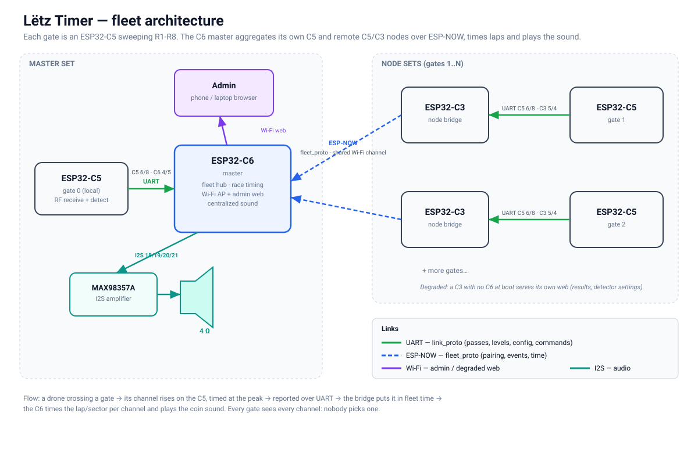

# FPV 5.8 Checkpoint

A **"a drone just passed"** platform: a C5 sweeps the 8 Raceband channels and
detects a drone pass on any of them, and a C6 master times it and plays a coin sound, with a
phone-friendly web UI to tune it and watch events. Each gate is a C5 wired to a
C3 (or to the C6); a C3 with no master in reach serves its own web page with the
passes. It scales to a multi-gate race-timing fleet.



> **Derivative and credits.** The detector's receive engine (`components/sdr_rx`) is ported from
> [widscan58](https://github.com/CapnBry/widscan58) by **CapnBry** (commit `a9fff97`: radio, calibration
> cache, PSD/FFT, level metrics, LO planner, linker guard), whose radio layer is derived from
> [esp-sdr](https://github.com/ESPARGOS/esp-sdr) by **ESPARGOS** (commit `a8eaac1`: the PHY I/Q dump
> capture, RX path, gain and analog filter control). Those files keep their GPL-3.0-or-later notices.
> This project was forked from [C5VRX](https://github.com/Twotoz/C5VRX) — **C5VRX-5, by Twotoz and the C5VRX
> contributors** (upstream `6bc9e4b`); the C5VRX receive engine was removed on this branch (issue #2), but
> C5VRX research is still used: the C5 PHY I/Q dump format first decoded by C5VRX-1, the console
> structure, the firmware id and NVS helpers, the Raceband scan benches and the off-grid tuning finding
> (zerowidth PR #3). Visit the [official C5VRX website](https://twotoz.github.io/C5VRX/) for the original
> project; its Discord invite is available there. This repository adds the pass detector, the coin
> sound (on the C6 master), and the C5↔C3/C6 platform around it. GPL-3.0-only (see `LICENSE`), without
> any warranty (sections 15–17); the C3 and C6 web pages show this notice in their footer. Not an
> official release of C5VRX, esp-sdr or widscan58, and not endorsed by their authors.

## What it is

- **ESP32-C5** (`firmware/detector`, Waveshare ESP32-C5-Zero) — runs the **sdr_rx**
  engine (`components/sdr_rx`): snapshots of the PHY's I/Q dump at 80 MS/s, one LO for
  two channels (5677/5751/5825/5899 MHz), a 4 × 64-point integer PSD with moment-based
  I/Q correction and the ±5 MHz band power of each channel, ~500 times a second per
  channel (widscan58's measurement; not yet measured on this board). It detects a pass
  on any of R1 to R8 and reports it over a UART link to its bridge. It has no local
  output: no picture, no amplifier and no status LED.
- **ESP32-C3** (`firmware/node`) — a node bridge: UART to the C5, ESP-NOW uplink to
  the C6 master; if no master is reachable at boot it falls back to a local
  Wi-Fi SoftAP + web (results, the C5's health and its
  calibrate/reboot commands).
- **ESP32-C6** (`firmware/master`) — the optional **race-timing master**: UART to its
  own C5, the centralized speaker, a Wi-Fi AP web, and an ESP-NOW hub that
  aggregates the C3 nodes. Each gate is a C5; the C6 times laps per channel,
  shows every gate's health and runs its calibrations and reboots (production
  has no USB console: [docs/fleet.md](docs/fleet.md#gate-health-and-remote-commands-no-console-in-production)).

The web has **two roles**: **spectators** watch the live standings and status
read-only (no login), while **admin** actions — pairing, gate order, reset,
volume, the fleet's re-arm drop, a gate's calibration or reboot, and (on a
degraded C3) detector tuning — require the admin password
(`CONFIG_*_ADMIN_PASSWORD`, no username): the admin toggle in the
header opens a password dialog. The password never crosses the Wi-Fi: the page
signs each admin request (HMAC-SHA256, per-session counter against replays)
with a key derived from it (PBKDF2), the only form the firmware holds (the tab keeps that key, never
the password, in its sessionStorage, so a reload stays admin until the tab closes or you switch admin off). A sniffed
request still allows offline guessing, so choose a long random password
([docs/fleet.md](docs/fleet.md), `components/web_auth`).

## Layout

```
components/
  sdr_rx/        receive engine (C5 only): dump capture, LO pairs, PSD + IQ correction (pure-C parts host-tested)
  checkpoint/    the scan task, console and benches, pass detection + the C5<->bridge UART link
  pass_detector/ pure-C pass detector and scan detector (host-tested)
  audio_player/  I2S coin-sound player (the C6 speaker in a fleet)
  link_proto/    pure-C C5<->bridge UART protocol (host-tested)
  fleet_proto/   pure-C C6<->C3 ESP-NOW protocol (host-tested)
  race_timing/   pure-C lap/sector timing engine (host-tested)
  espnow_link/   ESP-NOW transport carrying fleet_proto (C6 + C3)
  status_led/    single-WS2812 status indicator (pure-C core host-tested)
  web_auth/      signed admin requests for the C3/C6 web (pure-C core + auth.js host-tested)
firmware/detector/  ESP32-C5 application (RF + detection, report-only)
firmware/node/      ESP32-C3 node bridge (UART + ESP-NOW relay, degraded Wi-Fi web)
firmware/master/    ESP32-C6 master (UART + ESP-NOW hub + speaker + admin web + timing)
docs/            CHECKPOINT.md (index) + detector/no-video-audio/fleet/status-led/bench, wiring-*.svg
```

See **[docs/CHECKPOINT.md](docs/CHECKPOINT.md)** for the feature notes, the fleet
and the bench procedure, and **[docs/wiring-node.svg](docs/wiring-node.svg)** for
a gate's wiring (C3 + C5).

## Build

The root `Makefile` is the quick path: `make firmware` builds every variant,
`make flash [FW=<name>] [PORT=<port>]` flashes one (interactive firmware/port
menu if an arg is omitted), `make monitor`, `make variants` (list the `FW=`
names: `detector`/`node`/`master` defaults plus variants like
`detector-ipex` (a C5-Zero on its IPEX connector, for an external antenna),
`detector-xiao-c5`, `detector-wave-c5-lcd`, `master-wave-c5`), `make clean`. flash/monitor fall
back to esptool / a serial terminal on the already-built image when ESP-IDF is
not installed, so you can build in one place and flash in another.

For local, uncommitted settings — the Wi-Fi AP and admin-web passwords, or
enabling audio — put them in `firmware/<role>/sdkconfig.local.defaults` (one
`CONFIG_...=...` per line). It is gitignored, and `make`/`tools/fw.sh` append it
last so it overrides the committed defaults.

To work on the web pages without a board, `make web-master` (<http://127.0.0.1:8080/>)
or `make web-node` (port 8081) runs `tools/web_mock.py`: it serves the real pages from
disk, so a browser reload shows an edit, no build and no flash. `/api/*` answers like
the firmware on a simulated race (now and then a drone lingers at a gate, its channel
framed in cooldown), admin actions take effect (password `checkpoint`) and
signed requests are checked as on the ESP. `WEB_ARGS` passes its options: `--vtx` (a
strong carrier on every gate, for the calibration guard; each gate's channel then stays
in cooldown after its first pass), `--latency 300`, `--host
0.0.0.0` (to open it from a phone), `--password ""`. Stopping and restarting it is an
ESP reboot.

The raw commands:

```sh
. ~/esp/esp-idf-v6.0.2/export.sh
( cd firmware/detector && idf.py build )  # esp32c5 → build/detector-c5.bin (0 warnings)
( cd firmware/node && idf.py build )      # esp32c3 → build/node-c3.bin
( cd firmware/master && idf.py build )    # esp32c6 → build/master-c6.bin
# temporary "C5 as master" (run the master firmware on a spare C5 until the C6 arrives) → build-c5/master-c5.bin:
( cd firmware/master && idf.py -DIDF_TARGET=esp32c5 -DSDKCONFIG=sdkconfig.c5 \
    -DSDKCONFIG_DEFAULTS=sdkconfig.c5.defaults -B build-c5 build )

# Host tests
cd test
cc -O2 -std=c11 -Wall -Wextra -Werror -I../components/sdr_rx -I../components/sdr_rx/include test_sdr_dsp.c \
   ../components/sdr_rx/sdr_psd.c ../components/sdr_rx/sdr_level.c -lm -o /tmp/t && /tmp/t
cc -O2 -std=c11 -Wall -Wextra -Werror -I../components/sdr_rx -I../components/sdr_rx/include test_sdr_plan.c \
   ../components/sdr_rx/sdr_plan.c -o /tmp/t && /tmp/t
cc -O2 -std=c11 -Wall -Wextra -Werror -I../components/pass_detector/include \
   test_pass_detector.c ../components/pass_detector/pass_detector.c -lm -o /tmp/t && /tmp/t
cc -O2 -std=c11 -Wall -Wextra -Werror -I../components/pass_detector/include test_scan_detector.c \
   ../components/pass_detector/scan_detector.c ../components/pass_detector/pass_detector.c -lm -o /tmp/t && /tmp/t
cc -O2 -std=c11 -Wall -Wextra -Werror -I../components/pass_detector/include -I../components/sdr_rx \
   -I../components/sdr_rx/include test_pair_ghost.c ../components/pass_detector/scan_detector.c \
   ../components/pass_detector/pass_detector.c ../components/sdr_rx/sdr_psd.c ../components/sdr_rx/sdr_level.c \
   ../components/sdr_rx/sdr_plan.c -lm -o /tmp/t && /tmp/t   # the guard end to end on the DSP
cc -O2 -std=c11 -Wall -Wextra -Werror -I../components/audio_player/include \
   test_audio_resample.c -lm -o /tmp/t && /tmp/t
cc -O2 -std=c11 -Wall -Wextra -Werror -I../components/link_proto/include \
   test_link_proto.c ../components/link_proto/link_proto.c -o /tmp/t && /tmp/t
cc -O2 -std=c11 -Wall -Wextra -Werror -I../components/fleet_proto/include -I../components/link_proto/include \
   test_fleet_proto.c ../components/fleet_proto/fleet_proto.c ../components/link_proto/link_proto.c -o /tmp/t && /tmp/t
cc -O2 -std=c11 -Wall -Wextra -Werror -I../components/race_timing/include \
   test_race_timing.c ../components/race_timing/race_timing.c -o /tmp/t && /tmp/t
cc -O2 -std=c11 -Wall -Wextra -Werror -I../components/status_led/include \
   test_status_led.c ../components/status_led/status_led.c -o /tmp/t && /tmp/t
cc -O2 -std=c11 -Wall -Wextra -Werror -I../components/web_auth/include \
   test_web_auth.c ../components/web_auth/web_auth.c -o /tmp/t && /tmp/t
cc -O2 -std=c11 -Wall -Wextra -Werror -I../components/checkpoint \
   test_hop_stats.c -lm -o /tmp/t && /tmp/t
node test_web_auth.mjs   # the page side (auth.js), Node 18+
node test_web_bubble.mjs # the pages' info bubbles: one snippet, mouse, touch and keyboard
python3 test_web_mock.py # tools/web_mock.py against the firmware's /api/state and buffers
python3 test_pcb.py      # hardware/ boards against the firmware's Kconfig pin defaults
python3 test_scan_analyze.py   # tools/scan_analyze.py on synthetic recordings
python3 test_flash_tool.py     # tools/flash.py: download key, --check, logs
```

After editing a `firmware/detector/sdkconfig*.defaults`, run `tools/fw.sh clean`: it
deletes every build dir and generated `sdkconfig`/`sdkconfig.<variant>` (never a
`*.defaults`), since ESP-IDF never reapplies the defaults.

## Architecture

- **Global schema:** at the top of this page ([docs/fleet.svg](docs/fleet.svg)).
- **Pin-level wiring, per set type:**
  - master **C6 + C5**: [docs/wiring-master.svg](docs/wiring-master.svg)
  - node **C3 + C5** (also a gate with no master: the C3 then serves the web): [docs/wiring-node.svg](docs/wiring-node.svg)
  - temporary **C5 + C5** (a spare C5 runs the master firmware until the C6 arrives): [docs/wiring-c5c5.svg](docs/wiring-c5c5.svg)

## Pinout

Each UART link is crossed (one side's TX to the other's RX) with a common
ground. Pins are Kconfig defaults (`menuconfig`). USB-Serial-JTAG (flashing/console)
is reserved on every board. [`hardware/`](hardware/README.md) has carrier PCBs for
both sets, with Gerbers ready to order.

**ESP32-C5** (`firmware/detector`, detector — one per gate)

| Function | GPIO | Notes |
| --- | --- | --- |
| Link UART TX → bridge RX | 6 | to a C3 (node) or the C6 (master) |
| Link UART RX ← bridge TX | 8 | C5-Zero header pin (GPIO 15 is not broken out) |
| Amplifier / status LED | — | none on a detector: the C6 master plays the sound |
| forbidden | 13,14 (USB) · 16-22 (flash) · 26 (antenna) | console, flash, C5-Zero antenna switch |
| free | 0-5, 7, 9-12, 23-25, 27 | the sdr_rx engine uses no GPIO; 2, 7, 25, 27 (and 28, BOOT) are strapping pins: free after boot, no external pull or load that holds them at reset; 27 is the C5-Zero's WS2812 (unused) |

**ESP32-C3** (`firmware/node`, node bridge)

| Function | GPIO | Notes |
| --- | --- | --- |
| UART TX → C5 RX (8) | 5 | |
| UART RX ← C5 TX (6) | 4 | |
| Wi-Fi / ESP-NOW | — | no GPIO; ESP-NOW to the C6 on the shared AP channel |

**ESP32-C6** (`firmware/master`, master)

| Function | GPIO | Notes |
| --- | --- | --- |
| UART TX → local C5 RX (8) | 4 | |
| UART RX ← local C5 TX (6) | 5 | |
| Amplifier BCLK / LRC / DIN / SD | 18 / 19 / 20 / 21 | the centralized speaker; `VIN` 5 V, `OUT±` to a 4 Ω speaker |
| Wi-Fi AP + ESP-NOW | — | admin web + fleet hub; same channel as the nodes |

The C6 AP, the C3 APs and ESP-NOW must share the **same Wi-Fi channel**
(`CONFIG_C6_AP_CHANNEL` / `CONFIG_C3_AP_CHANNEL`).

## Safety

> [!WARNING]
> This is experimental and built on an experimental receive engine. Bugs, signal
> loss or automatic receive-chain changes can cause missed or false passes even
> after an apparently successful test. Do not rely on it as your only means of
> maintaining safe control of an aircraft.

## Attribution

Receive engine (`components/sdr_rx`): **widscan58** by CapnBry —
<https://github.com/CapnBry/widscan58>, commit `a9fff97`. Ported from its
`firmware/src/radio/` (`radio.h`; `c5/radio_c5.c`, `recal_c5.c`, `sram_guard.ld`,
`hot_iram.lf`), `firmware/src/dsp/` (`psd.c`, `fft_r4_sc16.h`, `fft_twiddle_q15.h`) and
`firmware/src/scan/` (`metrics.c`, `planner.c`, the hop of `scanner.c`); the bench
methods of `components/checkpoint/cp_bench.c` (tune timing, settle, image rejection,
noise per FFT size) follow its measurement log (`PLAN.md`). Its radio layer is derived
from **esp-sdr** by ESPARGOS — <https://github.com/ESPARGOS/esp-sdr>, commit `a8eaac1`
(`main/families/c5_c6_c61/receiver.c`, `main/targets/esp32c5/`,
`main/common/rx_recalibration.c`, `main/common/burst_gain.h`). The ported files keep
their GPL-3.0-or-later notices and list their changes in their headers.

History: this project was forked from **C5VRX** by Twotoz and the C5VRX contributors —
<https://github.com/Twotoz/C5VRX> · <https://twotoz.github.io/C5VRX/> (Discord
invite on the website), at upstream `6bc9e4b`. The C5VRX-5 receive engine ran the
detector until issue #2 and is removed on this branch (`main` keeps it until a board
bench validates sdr_rx). Still used from C5VRX-5: the console structure and its
download-key reboot (`components/checkpoint/cp_console.c`, the reboot of
`components/sdr_rx/sdr_radio_c5.c`), the firmware id and NVS helpers
(`components/checkpoint/fw_id.c`, `cp_nvs.c`), `tools/flash.py` and
`tools/enter_download.py`, and the off-grid tuning finding of zerowidth/C5VRX PR #3.
The Raceband scan benches this fork first built on the C5VRX engine (issue #1) give
`cp_bench.c` the shape of its scan recording and residue trace. Reused material keeps
its original copyright, license and credits; see `AGENTS.md` for the reuse policy and
`assets/BRANDING.md` for branding terms.

Research provenance: the PHY I/Q dump engine was first decoded in C5VRX-1 (librftest
`adctrig`, registers `0x600a9004/08/18`, bank `0x40830000`, 10-bit I/Q words: upstream
`legacy/c5vrx1/research/adc-dump-format.md`), and C5VRX-3/5 drove it continuously
(`enable_continuous_modem`, upstream `main/rf.c:119-147`). sdr_rx takes a different
route: one-shot snapshots, as esp-sdr and widscan58 trigger them. Source: raw source 15,
after the PHY's ADC-rate/RX-filter stage. Rate: 80 MS/s. Size: 256 words per capture
(3.2 µs). Ownership: CPU-polled, no DMA, no ring, no DAC. Word format: I bits 0–9,
Q bits 10–19, signed.

For the history, C5VRX-5 builds on C5VRX-2..4 (the continuous MODEM_DIAG to
BitScrambler video path, Direct Gain V3-V5, the PAIR schedule and the U85Q study of
PR #190), on zerowidth/C5VRX PR #3 (interference-burst gate, sampling-phase probe,
off-grid channel tuning), on Louis Hitchcock's staged overload recovery (C5VRX
#182/#184), and on ESPARGOS esp-sdr (GPL-3.0) for the C5 RX filter control. Espressif
supplied the GDMA EOF fix (espressif/esp-idf#19091).
