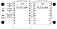
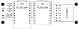

# Carrier boards

Two 2-layer boards that hold the modules of a set, every USB-C on the same edge, with solder
pads for the power.

| Board | Modules | Size | To order |
| --- | --- | --- | --- |
| node | C5-Zero + C3-Zero | 57 × 24 mm | [`gerbers/checkpoint-node-gerbers.zip`](gerbers/checkpoint-node-gerbers.zip) |
| master | C5-Zero + C6-Zero + MAX98357A | 79 × 24 mm | [`gerbers/checkpoint-master-gerbers.zip`](gerbers/checkpoint-master-gerbers.zip) |





**No board has been built yet.** The design rules pass, the drill data matches Waveshare's
drawings and `test/test_pcb.py` ties the nets to the firmware, but nothing has been soldered
or powered. Order a small batch first.

## Before ordering

Print `checkpoint-*/checkpoint-*-1to1.pdf` at 100 % and lay the real modules on the paper.
Check the MAX98357A closely: the footprint comes from Adafruit's board. Other breakouts
usually share its 7-pin order, but compare yours with the `LRC`…`VIN` labels on the board.

## Ordering

Upload the zip as it is. It holds both copper layers, solder mask, silkscreen, the outline
and the drill files.

2 layers, FR-4, 1.6 mm, 1 oz copper, any finish. No stencil or assembly needed.

## Parts

[`BOM.csv`](BOM.csv) lists each board's parts with an order reference. `test/test_pcb.py` checks
it against the node and master boards.

The `-M` Waveshare modules cost a little more but come with their headers fitted, which saves
the 1×9 headers and 18 joints per module. SS34 diodes must be in the **SMA** package.

## Assembly

1. Solder R1, R2, D1 and D2. The bar on a diode faces the module.
2. Before fitting a module, check J1 and J2 are not shorted, feed 5 V and read a little under
   5 V on the `5V` holes of U1 and U2.
3. Fit the modules on their headers, components up, **USB towards the top edge**. U1 hangs
   4 mm past the bottom edge, on purpose.
4. Master: fit the amplifier components up, its pin row on the `U3` labels. The speaker goes
   to the breakout's own terminal.

Then flash as usual, with `make flash FW=detector` for U1 and `FW=node` or `FW=master` for U2.

## Power

Feed the pads with **4.6 to 5.5 V**: 1 A for a node, 2 A for a master.

The `5V` pin of the C5-Zero and C3-Zero **is** the USB VBUS, with no diode (the C6-Zero has
its own B5819WS). Wired directly, a supply on the pads would feed the PC's USB port and two
cables would tie two hosts together. So each side gets its own diode, and USB can stay
plugged in while the pads are powered, which is the normal way to debug a running gate:

| Plugged in | C5 | C3 / C6 | Amplifier |
| --- | --- | --- | --- |
| Pads | on | on | on |
| USB on the C5 | on | off | off |
| USB on the C3 | off | on | — |
| USB on the C6 | off | on | on |
| Pads and any USB | on | on | on |

The diodes also protect the whole board if the power wires are swapped. They drop about 0.4 V,
which every regulator here tolerates. The 5.5 V limit is that of the C5-Zero's converter and
of the amplifier, kept on the pads as a margin.

R1 and R2 exist because of those diodes: a module can now be running while the other one is
off, and they hold the current into the sleeping chip's pin to about 3 mA. At 115200 baud
they change nothing.

## Layout notes

- **USB:** each module's end is flush with the top edge, so its USB-C sticks out by about
  1.6 mm and two plugs fit side by side. BOOT and RESET stay reachable on top.
- **Antennas:** the board stops short of the C5's ceramic antenna and IPEX connector, and a
  12 mm notch leaves no copper or FR-4 under any antenna.
- **Receiver pins:** the C5's GPIO 0 to 5 carry the IQ loopback and stay unconnected, like
  every C5 pin but `5V`, `GND` and the link (GPIO 6 and 8). Those two are not strapping pins.
- **C6 strapping pins:** the link uses GPIO 4 and 5, which only set the SDIO clock edges and do
  not affect a boot from flash. GPIO 8, 9 and 15 are left unconnected.
- **Speaker terminal:** its pins may poke through the breakout, so the master has no copper
  under them.

## Still to check on a real board

- **Detection:** the C5's antenna now sits about 2 cm from the C3's or C6's 2.4 GHz antenna.
  Compare the `levels` and false passes with the wired setup, with Wi-Fi active.
- **Heat** in D2 on a master at full volume.
- **Temporary C5-as-master set:** not supported, its amplifier pins differ.

## Antenna

[`antenna/`](antenna/README.md) holds a directive 5.8 GHz quasi-Yagi on FR-4, a separate board
that reaches a C5-Zero through its IPEX connector. It has not been simulated or built.

## Regenerating

[`generate_boards.py`](generate_boards.py) is the source of the boards: edit it, not the KiCad
files, which it overwrites. It needs KiCad 9 (`pcbnew` and `kicad-cli`):

```sh
python3 hardware/generate_boards.py   # writes the boards, fills, runs the DRC, exports
python3 test/test_pcb.py              # no KiCad needed; run in CI
```

The DRC result is printed for each board and must read `violations [] unconnected 0`.
