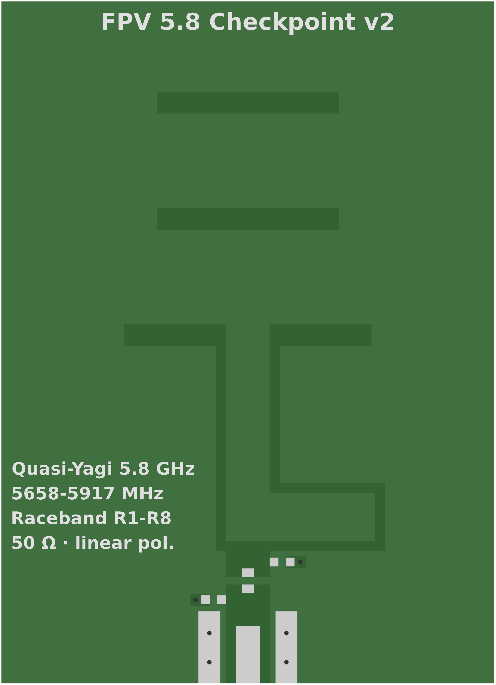
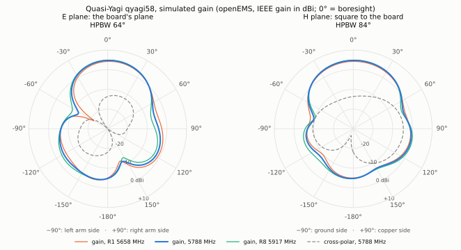
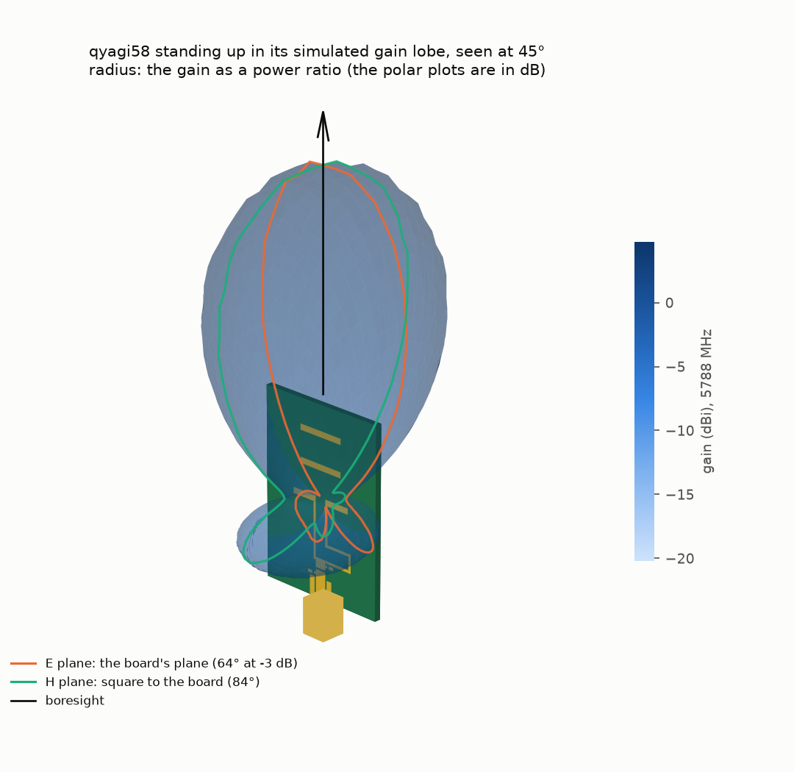
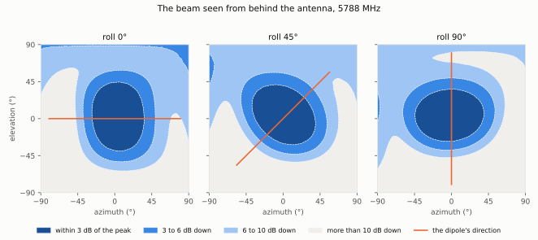
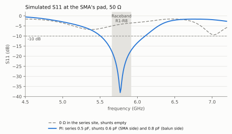

# Quasi-Yagi antenna

A directive printed antenna for the 5.8 GHz Raceband (5658-5917 MHz, R1 to R8), Qian/Itoh
topology, so a gate sees the drones in front of it rather than all around. It is the
directive antenna `docs/bench.md` leaves for later.

**It has been simulated, not built or measured.** Its openEMS model gives 4.2 to 4.9 dBi along
its axis across R1-R8, a beam 64° by 84° wide and a front-to-back ratio of 9.4 dB
([Simulation](#simulation)). The silkscreen states no gain until one is measured.



To order: [`../gerbers/qyagi58-v2-gerbers.zip`](../gerbers/qyagi58-v2-gerbers.zip), 2 layers,
FR-4, 1.6 mm, 1 oz copper, 34 × 47 mm.
JLCPCB canceled both V1 and V2 (see Versions): use another fab, or ask them why before sending
it there again.

Its parts are in [`../BOM.csv`](../BOM.csv). To use it on a gate, take an IPEX to SMA lead to the C5-Zero's IPEX connector, with `K` then
`i` on the bench or the `detector-ipex` firmware (`CONFIG_CHECKPOINT_ANTENNA_IPEX=y`), then
recalibrate (`docs/bench.md`).

## Versions

This is **V2**, the design below, and the version to order. Neither version has been built:
JLCPCB canceled both orders after its internal compliance assessment, without giving a reason.
V1's zip,
[`../gerbers/qyagi58-v1-gerbers.zip`](../gerbers/qyagi58-v1-gerbers.zip), only records that
design: do not order it.

| | V1 | V2 |
| --- | --- | --- |
| `XLOOP` (balun delay) | 26.5 mm (15.65 mm, 190° at mid-band) | 26.1 mm (14.85 mm, 180°) |
| `EDGE` (ground plane to the side edges) | 0, on the outline | 0.3 mm |
| `SILK` (spec block) | size 1.0, capitals 0.73 mm | size 1.2, capitals 0.87 mm |
| Silkscreen text | `50 Ω · pol. linéaire`, no version | `50 Ω · linear pol.`, `v2` in the title |
| SMA ground pads | generic, 2 × 5 mm at x = 10-12 and 22-24 | for a 6.0 mm leg span, 1.5 × 5 mm, 0.4 mm off the line |
| SMA centre pin | the whole 3 mm line bare | a 1.67 mm bare strip |
| PI and T junction | series at y = 5, T at y = 8 | series at y = 7.1, T at y = 9.5: the pads moved in |
| Driven dipole | 9.5 mm arms at y = 25.5, 9.5 mm past the ground edge | 7.0 mm arms at y = 24, 8 mm past it |
| Directors | 16.5 mm, at y = 34.5 and 43.5 | 12.5 mm, at y = 32 and 40 |

Everything else is the same. V2 changed after its canceled order: as no board was made, it
keeps its name. The last change shortened its radiators after the openEMS model (see
[Simulation](#simulation)): with V1's, the beam only ran along the board near 4.8 GHz, and at the
Raceband it left through the board's faces.
After an order, bump `VERSION` in the script before the next change.

## Design

Substrate: FR-4 1.6 mm, εr ≈ 4.4, 35 µm copper, λ0 ≈ 51.7 mm. The origin is the bottom left
corner and the antenna radiates towards +Y.

- **Back:** ground plane from y = 0 to 16 mm, 0.3 mm in from the left and right edges. Its
  top edge is the reflector.
- **Front, bottom to top:**
  - a 3 mm wide 50 Ω microstrip from an edge-launch SMA, whose ground legs land on a pad on
    each face, either side of the line. Its centre pin solders on a 1.67 mm strip of the line
    (`SMA_PIN` 1.27 mm, the usual width, + 0.2 mm each side): the rest of the line stays under
    the mask, away from the ground pads;
  - a PI footprint in 0402 on that line: the series part at y = 7.1 mm, where the line is
    cut, **so it always needs a part**, and two shunts, each with a via to ground. The
    simulation matches the antenna with **0.5 pF in series, 0.6 pF on the SMA side and 0.8 pF
    on the balun side** (C0G, ±0.05 pF). A 0 Ω alone leaves S11 at −3.5 to −5 dB;
  - a T junction at y = 9.5 mm into two 0.7 mm, 100 Ω branches. The right one detours to
    x = 26.1, y = 13.5 for λg/2 of extra length: that is the 180° balun. Past the ground
    edge the two branches become a CPS line, 3 mm apart;
  - the driven dipole at y = 24 mm: two 7.0 mm arms, a 3 mm gap, 17 mm overall, 1.5 mm wide;
  - two 12.5 × 1.5 mm directors at y = 32 and 40 mm.
- **Silkscreen:** text as outlines through matplotlib's `TextPath` (DejaVu Sans Bold), the
  letters' counters in clear polarity.

## Simulation

[`sim_qyagi.py`](sim_qyagi.py) builds an openEMS (FDTD) model from `gen_qyagi.py`'s own
geometry, and [`plot_qyagi.py`](plot_qyagi.py) draws the figures below from what it keeps in
[`qyagi58-sim.json`](qyagi58-sim.json).

- **Model:** FR-4 at εr 4.4 and tan δ 0.02, both copper layers as thin perfect conductors, the
  vias, and a 50 Ω port where the SMA's pin lands. The mesh has 0.77 M cells, 0.5 mm on the
  board, with absorbing (PML) walls. A run takes about a minute on 10 cores.
- **The PI:** a second model has four ports: the SMA's pad and the three 0402 sites. Every
  part tried on each site (inductors and capacitors in 0.1 steps up to 2 nH or 2 pF, then E12)
  is combined on their S-matrix, with each part's parasitics: 0.35 nH mounted, Q 30 for an inductor. The
  three capacitors above give the lowest worst-case S11 across R1-R8. Two parts alone (0.6 pF
  in series and on the balun side) only reach −14.6 dB.

| | R1 5658 MHz | 5788 MHz | R8 5917 MHz |
| --- | --- | --- | --- |
| Gain along the axis (IEEE) | 4.2 dBi | 4.7 dBi | 4.9 dBi |
| Realized gain, with the PI | 4.1 dBi | 4.6 dBi | 4.8 dBi |
| Front-to-back | 9.2 dB | 9.4 dB | 9.6 dB |
| −3 dB beamwidth, E plane (the board's) | 64° | 64° | 64° |
| −3 dB beamwidth, H plane (square to the board) | 87° | 84° | 81° |
| Cross-polar along the axis | −17.4 dB | −18.3 dB | −18.5 dB |
| Radiation efficiency (FR-4 losses) | 60 % | 61 % | 62 % |

S11 with the PI stays under −17 dB across R1-R8, and under −10 dB from 5.51 to 6.10 GHz.









**The beam is flattened.** It is 64° wide in the board's plane, where the dipole's own null
along its arms narrows it, and 84° wide square to the board. A gate therefore covers an ellipse,
long across the dipole. Rolling the antenna about its axis turns that ellipse: with the dipole
horizontal, the beam is narrow in azimuth and tall; with the dipole vertical, it is wide in
azimuth and flat. That is why the enclosure's arm also rolls the antenna
([`../enclosure/README.md`](../enclosure/README.md#antenna-arm)).

**Polarization.** The antenna is linear, along its dipole. Against a circularly polarized VTX,
as most FPV ones are, it loses 3 dB whatever its roll, so the roll only shapes the beam. Against
a linear VTX antenna, the dipole should also lie along the drone's antenna.

**Elsewhere:** −4.7 dBi straight behind, −1 dBi square to the copper face and −7 dBi square to
the ground side: the line and the balun radiate too.

**Sensitivity.**
- The PI's parts: at ±0.05 pF, S11 stays under −12 dB across R1-R8 in every corner; at
  ±0.1 pF, only under −8.9 dB. Buy the ±0.05 pF grade.
- FR-4's εr: from 4.2 to 4.6, the gain along the axis stays between 3.7 and 4.9 dBi across
  R1-R8 and the front-to-back between 8.4 and 9.9 dB. The match moves more, so the PI's values
  are the ones to check on the real board.

**What the model leaves out:** the SMA's body and the coax (whose shield carries some current),
the solder mask over the dipole and directors, the copper's thickness and roughness, the arm's
clamp (PETG on the ground band, behind the reflector) and the enclosure. Measure before trusting
the numbers.

V1's radiators, 9.5 mm arms and 16.5 mm directors, in the same model: the beam ran along the
board only near 4.8 GHz (4.0 dBi). From 5.2 GHz it left through the faces: at 5.8 GHz,
−1.1 dBi along the axis against +4.0 dBi square to the copper face.

## Open points

1. **Not measured.** The simulation is the only evidence. Check S11 with a VNA first, and
   change the PI's values if needed, then the pattern.
2. **Balun length.** The delay is 14.85 mm, λg/2 at 5788 MHz by the closed-form microstrip
   formulas, which ignore the four square bends. The simulated front-to-back (9.4 dB) and
   cross-polar level (−18 dB) say it works; a sweep of `XLOOP` has not been run.
3. **Silkscreen size.** The spec block is at size 1.2, so its capitals are 0.87 mm tall and it
   ends at x = 13.3, clear of the left branch at 14.8. Check that against the fab's minimum.
   Capitals of 1 mm need size 1.37, which runs into the branch, so the block would have to move.
4. **SMA footprint.** Fitted to an edge-launch SMA whose ground legs span 6.0 mm outside
   (`SMA_SPAN`, measured on the connector at hand). Each pad runs from 0.4 mm off the line to
   0.4 mm past the leg, so it takes legs up to 1.1 mm wide. Lay the connector on
   `qyagi58-1to1.pdf` printed at actual size before ordering (its 50 mm bar checks the scale).
5. **Tuning variants.** Dipole arms at ±0.3 mm, panelised, to choose from with a VNA.
6. **Gain on the silkscreen:** only once measured.
7. **Copper on the outline.** The ground plane still reaches the bottom edge, as do the
   microstrip and the SMA pads, because the edge-launch SMA needs them. A fab may flag that.
8. **Solder mask** covers the dipole and directors and is not in the model. It lowers the
   radiators' frequency a little, and the PI is where to correct it.

## Changing it

[`gen_qyagi.py`](gen_qyagi.py) is the source: change its parameters, not the Gerbers. Each run
writes the zip, reads it back with gerbonara, fails if a layer, the drill file or the board size
does not come back, and renders `qyagi58.svg`, `qyagi58.png` and `qyagi58-1to1.pdf`. Look at the render after each
change.

```sh
python3 -m venv /tmp/qyagi && /tmp/qyagi/bin/pip install matplotlib gerbonara
/tmp/qyagi/bin/python hardware/antenna/gen_qyagi.py   # the PNG also needs rsvg-convert
```

After a change to the copper, simulate again. [`sim_qyagi.py`](sim_qyagi.py) runs the five
models (about 10 minutes on 10 cores), writes `qyagi58-sim.json` and calls `plot_qyagi.py`,
which only needs numpy and matplotlib. It needs openEMS's Python bindings: on Debian 12,
`python3-openems` (0.0.35, which still uses `np.float`: the script shims it), with numpy below 2.

```sh
python3 hardware/antenna/sim_qyagi.py              # simulate, keep the JSON, plot
python3 hardware/antenna/sim_qyagi.py --plot       # plot again from the JSON
```
