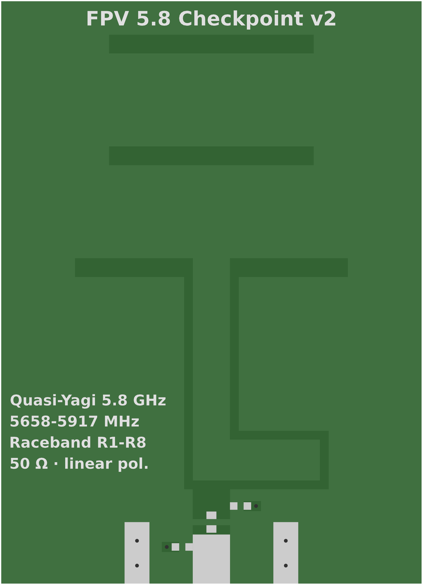

# Quasi-Yagi antenna

A directive printed antenna for the 5.8 GHz Raceband (5658-5917 MHz, R1 to R8), Qian/Itoh
topology, so a gate sees the drones in front of it rather than all around. It is the
directive antenna `docs/bench.md` leaves for later.

**It has not been simulated, built or measured.** Every dimension is a calculated starting
value, and the gain is unknown, which is why the silkscreen does not state one.



To order: [`../gerbers/qyagi58-v2-gerbers.zip`](../gerbers/qyagi58-v2-gerbers.zip), 2 layers,
FR-4, 1.6 mm, 1 oz copper, 34 × 47 mm.

Its parts are in [`../BOM.csv`](../BOM.csv). To use it on a gate, take an IPEX to SMA lead to the C5-Zero's IPEX connector, with `K` then
`i` on the bench or `CONFIG_CHECKPOINT_ANTENNA_IPEX=y`, then recalibrate (`docs/bench.md`).

## Versions

This is **V2**, the design below. V1 is already on order: measure it before ordering V2, since
what it shows may change V2's dimensions. It has no version on its silkscreen, and
[`../gerbers/qyagi58-v1-gerbers.zip`](../gerbers/qyagi58-v1-gerbers.zip) is kept as the record
of what was ordered, not to order again.

| | V1 | V2 |
| --- | --- | --- |
| `XLOOP` (balun delay) | 26.5 mm (15.65 mm, 190° at mid-band) | 26.1 mm (14.85 mm, 180°) |
| `EDGE` (ground plane to the side edges) | 0, on the outline | 0.3 mm |
| `SILK` (spec block) | size 1.0, capitals 0.73 mm | size 1.2, capitals 0.87 mm |
| Silkscreen text | `50 Ω · pol. linéaire`, no version | `50 Ω · linear pol.`, `v2` in the title |

Everything else is the same. The dipole and directors did not change, so V1 measures them too.
After an order, bump `VERSION` in the script before the next change.

## Design

Substrate: FR-4 1.6 mm, εr ≈ 4.4, 35 µm copper, λ0 ≈ 51.7 mm. The origin is the bottom left
corner and the antenna radiates towards +Y.

- **Back:** ground plane from y = 0 to 16 mm, 0.3 mm in from the left and right edges. Its
  top edge is the reflector.
- **Front, bottom to top:**
  - a 3 mm wide 50 Ω microstrip from an edge-launch SMA;
  - a PI footprint in 0402 on that line: the series part at y = 5 mm, where the line is
    cut, **so it needs at least a 0 Ω**, and two shunts left unfitted, with a via to ground;
  - a T junction at y = 8 mm into two 0.7 mm, 100 Ω branches. The right one detours to
    x = 26.1, y = 12 for λg/2 of extra length: that is the 180° balun. Past the ground
    edge the two branches become a CPS line, 3 mm apart;
  - the driven dipole at y = 25.5 mm: two 9.5 mm arms, a 3 mm gap, 22 mm overall, 1.5 mm wide;
  - two 16.5 × 1.5 mm directors at y = 34.5 and 43.5 mm.
- **Silkscreen:** text as outlines through matplotlib's `TextPath` (DejaVu Sans Bold), the
  letters' counters in clear polarity.

## Open points

1. **No EM simulation.** Next step: an openEMS model on the script's own parameters, aiming
   for S11 < −10 dB across the Raceband, and giving the gain and front-to-back ratio.
2. **Balun length.** The delay is 14.85 mm. At εr 4.4 the closed-form microstrip formulas make
   that λg/2 at 5788 MHz: 180° at mid-band, 176° at R1 and 184° at R8. They ignore the four
   square bends, so settle it in simulation.
3. **Silkscreen size.** The spec block is at size 1.2, so its capitals are 0.87 mm tall and it
   ends at x = 13.3, clear of the left branch at 14.8. Check that against the fab's minimum.
   Capitals of 1 mm need size 1.37, which runs into the branch, so the block would have to move.
4. **SMA footprint.** The ground pads (2 × 5 mm at x = 10-12 and 22-24) are generic: fit them
   to the real connector.
5. **Tuning variants.** Dipole arms at ±0.3 mm, panelised, to choose from with a VNA.
6. **Gain on the silkscreen:** only once measured.
7. **Copper on the outline.** The ground plane still reaches the bottom edge, as do the
   microstrip and the SMA pads, because the edge-launch SMA needs them. A fab may flag that.
8. **Not in the calculations yet:** the series 0402 is about 0.5 mm wide on a 3 mm line with
   no taper, and solder mask covers the dipole and directors. The simulation should model both.

## Changing it

[`gen_qyagi.py`](gen_qyagi.py) is the source: change its parameters, not the Gerbers. Each run
writes the zip, reads it back with gerbonara, fails if a layer, the drill file or the board size
does not come back, and renders `qyagi58.svg` and `qyagi58.png`. Look at the render after each
change.

```sh
python3 -m venv /tmp/qyagi && /tmp/qyagi/bin/pip install matplotlib gerbonara
/tmp/qyagi/bin/python hardware/antenna/gen_qyagi.py   # the PNG also needs rsvg-convert
```
