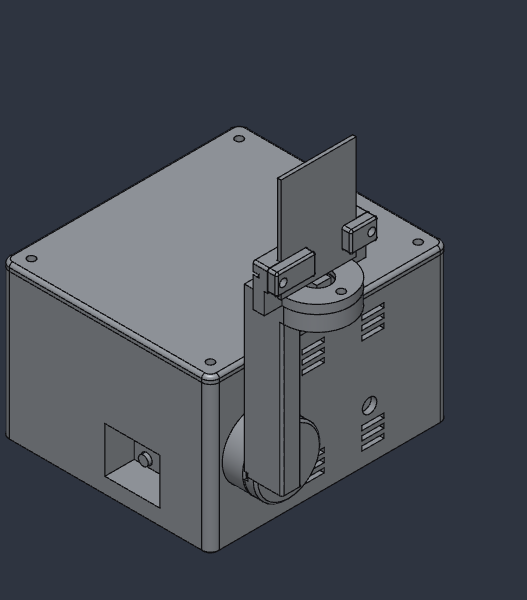

# Enclosure

A 3D-printed box for a node set (C5 + C3 carrier) or a master set (C5 + C6 carrier and its
speaker), with a LiPo cut-off and a DC-DC converter, and the antenna on an arm outside.

**Nothing has been printed yet.** The parts fit together in the model, with no interference
and no support needed, but several dimensions come from a photo or are assumed (see
[Before printing](#before-printing)).

## Files

| File | What |
| --- | --- |
| [`enclosure.sc`](enclosure.sc) | the source: a [SolidCraft](https://github.com/tangency-labs/solidcraft) 0.41 design where every dimension is a named parameter with a comment |
| [`print/common/`](print/common/) | the parts both sets share: plates 1 and 2, button pushers, dial post, arm, clamp jaws |
| [`print/master/`](print/master/), [`print/node/`](print/node/) | the box, the lid and plate 3 of each set |

Every 3MF is already laid on its print face.

The design has two configurations, `master` and `node`. They differ in:

- **the carrier on plate 3:** 79 or 57 mm long (`carrier_l`);
- **the speaker:** its frame and grille, master only;
- **the room behind plate 3** (`back_room`): the node's box is 4.7 mm shorter.

The box keeps the same width for both. A narrower node box would put the cut-off against the
lid columns and the XT60.

The standoffs of plates 1 and 2 are dimensioned in their `standoffs` sketch from an outline of
the module (construction lines driven by its size and position). The insert holes are centred on
those standoffs, projected into the `inserts` sketch, so they follow them.

After a change, activate each configuration and export its printed bodies again, with "lay on
print faces": their print faces are set in the design. The envelopes of the modules and of the
XT60E-M (from its STEP model), the antenna and its SMA jack are references, not parts.

## Layout

Inside 90 × 103 × 64 mm for a master (98.3 mm deep for a node), outside 95 × 108 × 70 mm with
the lid (103.3 mm deep for a node), without the arm.

- **Plates:** three of them slide down rails, front to back:
  1. the cut-off, its display and buttons facing the front window;
  2. the DC-DC converter;
  3. the carrier, its USB-C at the top, reachable with the lid off.

  Wires pass from one plate to the next through the notches at their top.
- **Walls:**
  - front: a recess brings the window to 1 mm from the display, and two printed pushers
    reach the cut-off's buttons;
  - left: the XT60E-M for the LiPo, its flange inside against the wall and its nose 0.55 mm
    out. Its solder cups end 2.9 mm from the cut-off: bend the wires right away;
  - right: the SMA bulkhead under the carrier, and the dial of the antenna arm;
  - back, master only: the speaker (28 × 31 mm, 15 mm deep) behind a grille. Its front 6 mm
    sit in a frame, cable out at the top, and its two ears rest on the frame's edge and screw
    into M2 inserts on two pillars rising from the floor.
- **Vents:** grilles low and high, on both sides of the DC-DC and carrier compartments.
- **Lid:** 4 M3 screws into inserts; it also holds the plates down.

## Antenna arm

- **Positions:** the arm turns about an axis square to the right wall and locks in 8
  positions 45° apart (up, down, front, back and the diagonals). Loosen its M3 screw, turn it
  a notch, tighten it.
- **Clamps:** two jaws hold the antenna by its ground band, 5.5 to 15 mm from the SMA edge,
  and stay clear of the line, the PI and the balun.
- **Pointing down:** the antenna then reaches 36 mm below the bottom of the box, so raise the box.
- **Coax:** up to 150 mm from the bulkhead to the antenna. Its plug on the wall must stand
  under 20 mm, or the antenna hits it when pointing back. A right-angle plug clears it.
- **Firmware:** flash the C5 with `make flash FW=detector-ipex` (`CONFIG_CHECKPOINT_ANTENNA_IPEX=y`),
  then calibrate again with every VTX off. Without it, the C5 listens on its onboard antenna,
  inside the box.

## Printing

PETG, 3 perimeters (for the inserts), 20 to 30 % infill, no supports. The longest bridges are
about 25 mm, over the recess and the speaker grille. Print one plate first and try an insert
in its 4.2 mm holes (`insert_d`).

## Assembly

1. Set the heat-set inserts (16 M3x5x5, 1 M3x6x5 in the dial post, and on a master 2 M2x4x3.2
   for the speaker).
2. Screw the dial post on from inside the box (2 M3 x 8), before plate 1 goes in.
3. Fit the XT60E-M from inside (2 M2.5 x 10 screws and nuts), the SMA bulkhead and, on a
   master, the speaker (2 M2 x 6).
4. Screw each module on its plate. Put the two pushers in their holes, then slide plate 1 in,
   then plates 2 and 3.
5. Wire through the plate notches, then screw the lid on (4 M3 x 8).
6. Clamp the antenna (2 M3 x 18, nuts in the arm), fit the arm (M3 x 10 and a washer).

The parts and screws are listed in [`../BOM.csv`](../BOM.csv), rows `enclosure` and `power`
(one set of each per box).

## Before printing

Measure these on the real parts and change the parameter if it differs:

| Parameter | Now | What |
| --- | --- | --- |
| `disp_t`, `btn_t` | 8, 5 mm | assumed: height of the cut-off's display and buttons above its board |
| `disp_x0`, `disp_z0`, `disp_w`, `disp_h`, `btn1_x`, `btn2_x`, `btn_z` | from a photo | cut-off display and buttons, about 1 mm |
| `relay_z0` | 25.9 mm | from a photo: the relay slides past the recess, `relay_clear` must stay above 0 |
