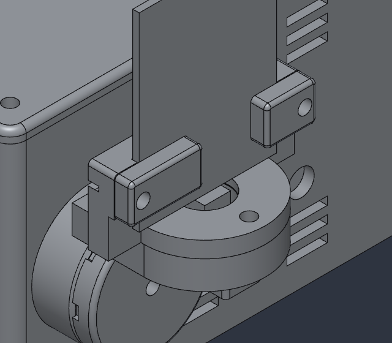

# Enclosure

A 3D-printed box for a node set (C5 + C3 carrier) or a master set (C5 + C6 carrier and its
speaker), with a LiPo cut-off and a DC-DC converter, and the antenna on an arm outside.


**Nothing has been printed yet.** The parts fit together in the model, with no interference
and no support needed, but several dimensions come from a photo or are assumed (see
[Before printing](#before-printing)).

## Files

| File | What |
| --- | --- |
| [`enclosure.sc`](enclosure.sc) | the source: a [SolidCraft](https://github.com/tangency-labs/solidcraft) 0.41 design where every dimension is a named parameter with a comment |
| [`print/common/`](print/common/) | the parts both sets share: plates 1 and 2, button pushers, dial post, arm, roll clamp, front jaws |
| [`print/master/`](print/master/), [`print/node/`](print/node/) | the box, the lid and plate 3 of each set |

Every 3MF is already laid on its print face.

The design has two configurations, `master` and `node`. They differ in:

- **the carrier on plate 3:** 79 or 57 mm long (`carrier_l`);
- **the speaker:** its frame and grille, master only;
- **the room behind plate 3** (`back_room`): the node's box is 4.7 mm shorter.

The box keeps the same width for both. A narrower node box would put the cut-off against the
lid columns and the XT60.

The standoffs of plates 1 and 2 are dimensioned in their `standoffs` sketch from an outline of
the module (construction lines driven by its size and position). The insert holes are centred on
those standoffs, projected into the `inserts` sketch, so they follow them.

After a change, activate each configuration and export its printed bodies again, in fine quality
with "lay on print faces". Set each body's print face first (`body.print_face`): the saved design
does not keep them. The arm lies on its back, the roll clamp on its plate, the front jaws on the
face against the antenna. The envelopes of the modules and of the
XT60E-M (from its STEP model), the antenna and its SMA jack are references, not parts.

## Layout

Inside 90 × 103 × 64 mm for a master (98.3 mm deep for a node), outside 95 × 108 × 70 mm with
the lid (103.3 mm deep for a node), without the arm.

- **Plates:** three of them slide down rails, front to back:
  1. the cut-off, its display and buttons facing the front window;
  2. the DC-DC converter;
  3. the carrier, its USB-C at the top, reachable with the lid off. In the model its USB-C
     stand 6.5 mm under the lid (`lid_clear`): at 1.5 mm the real C5 touched it.

  Wires pass from one plate to the next through the notches at their top.
- **Walls:**
  - front: a recess brings the window to 1 mm from the display, and two printed pushers
    reach the cut-off's buttons;
  - left: the XT60E-M for the LiPo, its flange inside against the wall and its nose 0.55 mm
    out. Its solder cups end 2.9 mm from the cut-off: bend the wires right away;
  - right: the SMA bulkhead under the carrier, and the dial of the antenna arm;
  - back, master only: the speaker (28 × 31 mm, 15 mm deep) behind a grille. Its front 6 mm
    sit in a frame, cable out at the top, and its two ears rest on the frame's edge and screw
    into M2 inserts on two pillars rising from the floor.
- **Vents:** grilles low and high, on both sides of the DC-DC and carrier compartments.
- **Lid:** 4 M3 screws into inserts; it also holds the plates down.

## Editing the design

Work **in `enclosure.sc` itself**, not on a copy or an exported mesh: it is the source, and the
3MFs in `print/` are re-exported from it after every change. The headless CLI of SolidCraft
(`solidcraft-cli`, in the release tarball, no display needed) opens it, changes it and saves it
back in place:

```sh
CLI=path/to/solidcraft-0.41.0-linux-aarch64/bin/solidcraft-cli
cat > /tmp/change.json <<'EOF'
{"commands": [{"command": "parameters.change", "params": {"name": "leg_d", "expression": "3"}}]}
EOF
$CLI run /tmp/change.json --in enclosure.sc --save enclosure.sc --quiet   # edit in place
$CLI eval enclosure.sc --json-out /tmp/e.json    # volume, bounding box, mass of every body
$CLI commands                                    # every command and its parameters
```

- **Change a parameter, not the geometry:** `parameters.change` (or `parameters.add` for a new
  one, with a `comment`). Every dimension is a named parameter, and a sketch point takes an
  expression (`dial_y - leg_hw`). For a new dimension, add the parameter, then point the
  sketch's expression at it.
- **Check what moved:** `eval` before and after. Only the body you meant to change should have
  another volume, and both configurations (`config.activate`, `master` and `node`) must still
  rebuild.
- **Re-export the parts that changed**, in the same run, fine quality, laid on their print face
  (`body.print_face` takes a point on a flat face, in the model's coordinates, and is not saved
  in the design). The roll clamp, for instance, lies on its plate:

  ```json
  {"commands": [
    {"command": "body.print_face", "params": {"body": "Antenna roll clamp", "point": [128.3, 17.85, 107.1]}},
    {"command": "file.export", "params": {"path": "print/common/antenna-roll-clamp.3mf", "format": "3mf",
     "bodies": ["Antenna roll clamp"], "quality": "fine", "lay_on_print_faces": true}}]}
  ```

  Export the part first from the unchanged design: it must match the committed 3MF (same
  bounding box, same orientation) before you trust the new one.
- **What the CLI does to the file:** the saved design is named after its file (keep it
  `enclosure.sc`), and the thumbnail (`cache/thumbnail.*`) is dropped: copy it back from the
  previous file, or save once from the app. `enclosure.sc.bak` and `.*~*.sc.lock*` are the app's
  own and are ignored by git.
- **File format:** the file is saved by a newer SolidCraft than the CLI 0.41 reads (format 58,
  the CLI reads 55). It prints a warning and rebuilds everything all the same: compare the saved
  `document.json` with the old one (only your parameters and features should differ). Open the
  file in the desktop app once before a print.

## Antenna arm



- **Positions:** the arm turns about an axis square to the right wall and locks in 8
  positions 45° apart (up, down, front, back and the diagonals). Loosen its M3 screw, turn it
  a notch, tighten it.
- **Length:** 75 mm from the dial's axis to the roll joint (`arm_l`), so the antenna stands
  clear of the box. Its bar runs on the side of the axis away from the wall's SMA bulkhead.
- **Roll:** the antenna also turns about its own axis, in 8 steps of 45°: its dipole along the
  wall, square to it or at 45°. Its beam is 64° wide in the board's plane and 84° square to it
  ([`../antenna/README.md`](../antenna/README.md#simulation)), so the roll chooses which way it
  is narrow. The roll clamp sits on a seat at the end of the arm, centred by a lip, and two
  M3 × 8 screws hold it in two opposite inserts of the seat's eight. Take them out, turn the
  clamp, and screw them into the two inserts now under its holes.
- **Clamps:** the roll clamp's rear jaw and two front jaws hold the antenna by its ground band,
  5.5 to 15 mm from the SMA edge, and stay clear of the line, the PI and the balun. A pocket in
  the rear jaw takes the SMA's legs: 20 mm wide (`leg_hw`), the V1 board's 14 mm leg span
  (`sma_span`, pads at 10-12 and 22-24 mm) plus 3 mm of air on each side (`sma_margin`), so a V2
  board's 6 mm span fits too. It is 3 mm deep (`leg_d`) in the 5 mm jaw (`rear_t`):
  keep at least 1.2 mm (3 perimeters) of jaw behind it. It stops 0.5 mm past the V1 pads' 5 mm, where the clamped band starts.
- **Clearance:** pointing back, the roll joint is partly beside the wall. Rolled 90°, the jaws
  come within 4 mm of the wall's plane and never closer: the arm's rise (`riser`, 12 mm) is set
  for that.
- **Pointing down:** the antenna then reaches 91 mm below the bottom of the box, so raise the
  box or point it another way.
- **Coax:** 200 mm from the bulkhead to the antenna (`coax_l`): 125 mm in a straight line at
  the worst arm angle, plus the way round the hub. At the antenna it needs a straight plug: the
  cable runs down the roll axis, through the 12 mm bore of the clamp and the seat, then along
  the arm. No arm angle or roll reaches the plug on the wall, whatever its height.
- **Firmware:** flash the C5 with `make flash FW=detector-ipex` (`CONFIG_CHECKPOINT_ANTENNA_IPEX=y`),
  then calibrate again with every VTX off. Without it, the C5 listens on its onboard antenna,
  inside the box.

## Printing

PETG, 3 perimeters (for the inserts), 20 to 30 % infill, no supports. The longest bridges are
about 25 mm, over the recess and the speaker grille. Print one plate first and try an insert
in its 4.2 mm holes (`insert_d`).

## Assembly

1. Set the heat-set inserts (24 M3x5x5, 8 of them in the arm's roll seat, 1 M3x6x5 in the dial
   post, and on a master 2 M2x4x3.2 for the speaker).
2. Screw the dial post on from inside the box (2 M3 x 8), before plate 1 goes in.
3. Fit the XT60E-M from inside (2 M2.5 x 10 screws and nuts), the SMA bulkhead and, on a
   master, the speaker (2 M2 x 6).
4. Screw each module on its plate. Put the two pushers in their holes, then slide plate 1 in,
   then plates 2 and 3.
5. Wire through the plate notches, then screw the lid on (4 M3 x 8).
6. Fit the arm (M3 x 10 and a washer). Pass the coax's antenna end up through the seat and the
   roll clamp's bore, screw it on the antenna, and clamp the antenna to the roll clamp
   (2 M3 x 12, nuts in the roll clamp). Then set the roll clamp on the seat (2 M3 x 8).

The parts and screws are listed in [`../BOM.csv`](../BOM.csv), rows `enclosure` and `power`
(one set of each per box).

## Before printing

Measure these on the real parts and change the parameter if it differs:

| Parameter | Now | What |
| --- | --- | --- |
| `disp_t`, `btn_t` | 8, 5 mm | assumed: height of the cut-off's display and buttons above its board |
| `disp_x0`, `disp_z0`, `disp_w`, `disp_h`, `btn1_x`, `btn2_x`, `btn_z` | from a photo | cut-off display and buttons, about 1 mm |
| `relay_z0` | 25.9 mm | from a photo: the relay slides past the recess, `relay_clear` must stay above 0 |
| `lid_clear` | 6.5 mm | the C5 stands higher than the 1.6 mm of USB-C the model gives it (`usb_out`). The plugs now go 6 mm down between plates 2 and 3: one up to about 9 mm thick fits, most are 6.5 to 7.5 mm |
